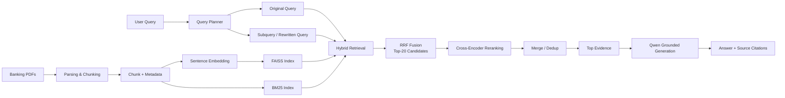
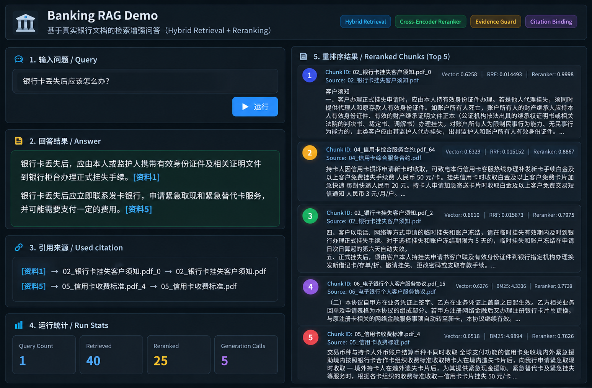
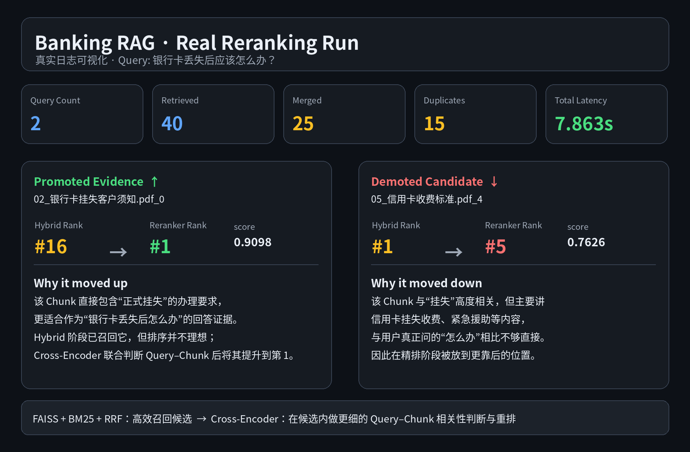

<div align="center">

# Banking RAG Retrieval and Question Answering System

**Hybrid Retrieval · Cross-Encoder Reranking · Grounded Generation**

基于公开银行业务文档构建的检索增强问答系统，覆盖文档解析、混合检索、精排、证据式生成、引用与低证据处理。

</div>

---

## Project Overview | 项目简介

This project builds a banking-domain Retrieval-Augmented Generation (RAG) pipeline over public banking documents. The system focuses on retrieval quality, evidence traceability, and grounded answer generation rather than treating the LLM as a standalone knowledge source.

本项目基于公开银行业务文档构建银行领域 Retrieval-Augmented Generation（RAG）系统。系统重点关注**检索质量、证据可追溯性和基于证据的回答生成**，而不是让 LLM 脱离知识库直接回答。

### Core Pipeline | 核心流程

- PDF parsing and chunking
- Metadata preservation
- Dense retrieval with Sentence Embedding + FAISS
- Sparse retrieval with BM25
- Rank fusion with RRF
- Cross-Encoder reranking
- Evidence-based answer generation with Qwen
- Source citation and low-evidence handling

---

## Tech Stack | 技术栈

`Python` · `FAISS` · `BM25` · `Sentence Transformers` · `Cross-Encoder` · `Qwen` · `RRF`

---

## System Architecture | 系统架构



---

## Retrieval and Reranking Design | 检索与精排设计

### 1. Hybrid Retrieval

FAISS and BM25 both measure relevance, but in different ways:

- **BM25** focuses on lexical overlap and term importance.
- **FAISS dense retrieval** compares separately encoded Query and Chunk vectors to find semantically similar content.
- **RRF (Reciprocal Rank Fusion)** combines the rankings from the two retrievers into a unified candidate list.

FAISS 和 BM25 都在做相关性判断，但判断方式不同：

- **BM25** 主要看关键词匹配及词项重要性；
- **FAISS Dense Retrieval** 将 Query 和 Chunk 分别编码成向量，再比较向量相似度，用于寻找整体语义相近的内容；
- **RRF** 根据两路检索的排名进行融合，形成统一的候选列表。

### 2. Why Cross-Encoder Reranking?

Hybrid Retrieval is already relevant retrieval. The purpose of the Cross-Encoder is **not to solve “no relevance”**, but to make the ranking inside the candidate set more precise.

The first stage must scan a large corpus efficiently, so BM25 and dense retrieval use relatively lightweight scoring. After the candidate set has been reduced to about Top-20, the Cross-Encoder can afford a more expensive comparison: it jointly encodes the Query and each candidate Chunk in the same Transformer and directly predicts fine-grained relevance.

Therefore, the two-stage design is:

> **FAISS + BM25 + RRF: fast candidate retrieval → Cross-Encoder: precise candidate reranking**

Hybrid Retrieval 本身已经在做相关性检索。引入 Cross-Encoder 的原因并不是“前面无法判断相关性”，而是为了让**候选集合内部的排序更准确**。

第一阶段面对整个知识库，需要兼顾速度，因此 BM25 和 Dense Retrieval 使用更高效的打分方式；当候选已经缩小到 Top-20 左右后，就可以使用计算更贵但判断更细的 Cross-Encoder：它将 **Query 和候选 Chunk 联合输入同一个 Transformer**，让两者发生更细粒度的 token-level interaction，再判断哪条证据最适合当前问题。

因此整个设计可以概括为：

> **FAISS + BM25 + RRF：快速召回候选 → Cross-Encoder：在候选内精确重排**

---

## End-to-End Demo | 端到端问答演示

The following screenshot shows an end-to-end run of the current Banking RAG pipeline, including user query input, grounded answer generation, source citation, runtime statistics, and the Top-5 reranked evidence chunks.

下图展示当前 Banking RAG 主链的一次端到端运行结果，包括用户问题输入、基于证据的回答生成、引用来源、运行统计，以及 Cross-Encoder 重排后的 Top-5 Evidence。



---

## Real Reranking Example | 真实重排案例

The following example comes from an actual project run.

**Query**

> 银行卡丢失后应该怎么办？



### What happened?

For the original query:

- `02_银行卡挂失客户须知.pdf_0` was only **Hybrid Rank #16**, but the Cross-Encoder promoted it to **Reranker Rank #1** with a score of **0.9098**.
- `05_信用卡收费标准.pdf_4` was **Hybrid Rank #1**, but it mainly discussed card-loss fees and related services. The Cross-Encoder moved it down to **Reranker Rank #5** with a score of **0.7626**.

This is exactly the role of the reranker: Hybrid Retrieval successfully retrieves relevant candidates, while the Cross-Encoder further distinguishes between **“topic-related”** evidence and evidence that **more directly answers the concrete user question**.

真实运行中：

- `02_银行卡挂失客户须知.pdf_0` 在 Hybrid Retrieval 中仅排 **第 16**，但它直接包含正式挂失办理要求，因此经 Cross-Encoder 后提升至 **第 1**，分数为 **0.9098**；
- `05_信用卡收费标准.pdf_4` 在 Hybrid Retrieval 中排 **第 1**，但主要内容是挂失收费、紧急援助等，虽然主题相关，却不如前者直接回答“丢失后怎么办”，因此被重排到 **第 5**，分数为 **0.7626**。

这个案例说明：**Hybrid Retrieval 能把相关候选找出来，但候选内部的初始排名仍可能偏向“主题相关”；Cross-Encoder 再进一步判断哪条 Chunk 更适合作为当前问题的回答证据。**

### Execution Summary | 本次运行摘要

| Metric | Value |
|---|---:|
| Query count | 2 |
| Retrieved chunk count | 40 |
| Merged chunk count | 25 |
| Duplicate chunk count | 15 |
| Reranker pair count | 40 |
| Planner latency | 5.067 s |
| Retrieval latency | 0.020 s |
| Reranker latency | 2.776 s |
| Total latency | 7.863 s |

---

## Evaluation | 评测

Representative locked-baseline results:

| Metric | Result |
|---|---:|
| Hybrid Hit@5 | 94% |
| Hybrid Complete@5 | 92% |
| Hybrid Complete@20 | 100% |

The evaluation is designed to separate several questions:

- **Hit@K**: whether at least one useful evidence chunk is retrieved.
- **Complete@K**: whether the retrieved evidence is sufficient to cover the information required by the query.
- **MRR**: how early the first relevant result appears.
- **Reranking evaluation**: whether the Cross-Encoder improves the ordering of already-retrieved candidates.

评测不仅关注“有没有召回相关 Chunk”，还区分：

- **Hit@K**：Top-K 中是否至少出现一条有效证据；
- **Complete@K**：Top-K 是否覆盖回答问题所需的完整证据；
- **MRR**：第一条相关结果出现得是否足够靠前；
- **Reranking evaluation**：Cross-Encoder 是否改善了已召回候选的排序质量。

---

## Relevance vs. Evidence Sufficiency | 相关性与证据充分性

A high reranker score means that a Query–Chunk pair is highly relevant. It does **not** automatically mean that the entire evidence set is sufficient to answer a complex question.

Therefore, reranker scores should not be treated as an absolute confidence score for the final answer.

较高的 Reranker 分数表示某个 **Query–Chunk pair 的相关性较高**，但并不等价于“整组证据已经足够回答复杂问题”。

因此，本项目不把 Reranker 分数直接当作最终回答的绝对置信度，而是将 **单条 Chunk 相关性** 与 **整组 Evidence Sufficiency** 区分开来。

---

## Query Decomposition Experiment | 查询拆分实验

Query decomposition was explored for multi-point or complex questions. The planner can rewrite or split the original query into subqueries and retrieve evidence separately before merging and deduplicating results.

Development-set results showed potential improvement in evidence coverage, but the gain was not stable on the locked evaluation set and latency increased significantly. Therefore, query decomposition is kept as an experimental component rather than being treated as an unconditional default.

本项目也尝试了针对复杂、多点问题的 Query Decomposition：由 Query Planner 对原始问题进行改写或拆分，再分别检索，最后合并和去重证据。

该方法在开发集上对 Evidence Coverage 有一定提升，但在锁定评测集上的收益不稳定，同时显著增加延迟，因此目前将其保留为**实验性能力**，而不是默认对所有问题开启。

---

## Grounded Generation | 基于证据的生成

The generator receives only the selected evidence and is instructed to answer based on that evidence, with source traceability retained through metadata.

生成阶段只接收经过检索与精排后的证据，并要求模型依据证据回答，同时利用 Metadata 保留来源信息，使答案能够追溯到原始文档。

---

## Why Not Rerank the Entire Corpus? | 为什么不对全库直接 Cross-Encoder 打分？

Cross-Encoder reranking is more accurate but much more expensive because the model must jointly process every Query–Chunk pair.

Applying it to the entire corpus would create unnecessary latency and computation cost. The two-stage retrieval architecture keeps the expensive model only for a small candidate set.

Cross-Encoder 的精度更高，但代价也更大，因为每个 Query–Chunk pair 都需要联合经过模型。

如果对全库所有 Chunk 都直接运行 Cross-Encoder，会带来明显的延迟和计算成本，因此采用两阶段架构：**先通过高效检索缩小范围，再对少量候选做精排。**

---

## Getting Started | 运行方式

```bash
python main.py
```

The interactive entry asks for a user query and runs the retrieval / reranking pipeline according to the current configuration.

运行后在终端输入问题，即可执行当前配置下的检索与精排流程。

---

## Future Work | 后续方向

- Build a dedicated multi-point challenge set for evidence sufficiency evaluation.
- Evaluate Query Decomposition with `Complete@K` and evidence-coverage metrics instead of relying only on retrieval relevance.
- Add post-generation hallucination verification: split the generated answer into factual claims and check each claim against the retrieved Top-K evidence.
- Rewrite, remove, or refuse unsupported claims without searching the entire corpus again.

后续计划包括：

- 构建专门面向复杂多点问题的 challenge set；
- 使用 `Complete@K` 和 Evidence Coverage 评估 Query Decomposition，而不仅仅看单条相关性；
- 增加生成后 Hallucination Verification：将答案拆成事实性 Claim，与 Top-K Evidence 逐条核对；
- 对缺乏证据支持的 Claim 进行重写、删除或拒答，而不是重新对全库检索。

---

## Design Philosophy | 设计思路

The project follows a simple principle:

> **Retrieve broadly, rerank precisely, generate only from evidence, and evaluate every stage separately.**

项目整体遵循：

> **先尽可能召回，再精确重排；生成必须基于证据，并且对检索、证据充分性和生成分别评测。**
